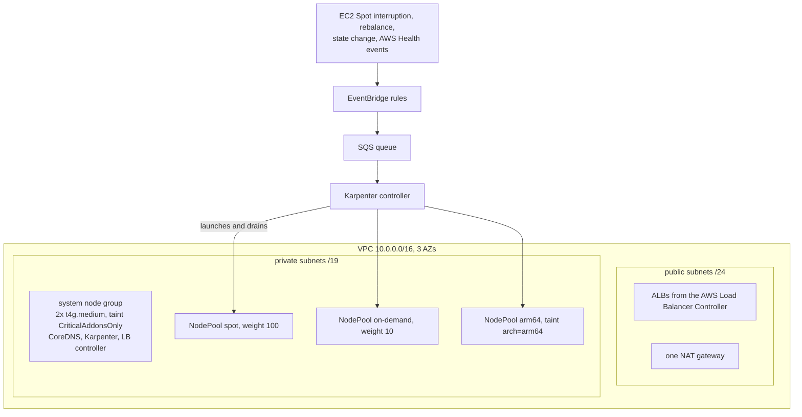

# eks-karpenter-spot

[](https://github.com/QwertyUser17/eks-karpenter-spot/actions/workflows/validate.yml)

## What it is and who it is for

Terraform for an EKS cluster where apps run on Spot instances through Karpenter. On-demand is only a fallback.

This is my approach to running apps on Spot in EKS. It grew out of real projects and has run in production, where moving stateless services to Spot this way cut compute spend by about 29%. This repository builds it again from scratch, in a better form.

It's for a team that runs stateless services on EKS, pays for on-demand nodes and wants to move to Spot without trouble from interruptions. The interesting part is "Decisions and why".

## Architecture



## Decisions and why

### Karpenter for apps, one small node group for controllers
Apps get nodes from Karpenter. It picks an instance type for the pods that are waiting, instead of scaling a fixed group. The only managed node group has two Graviton nodes with a `CriticalAddonsOnly` taint. CoreDNS, Karpenter and the LB controller run there, because Karpenter should not run on a node it can delete.

### Spot first, on-demand by weight
There are two x86 NodePools: spot with weight 100 and on-demand with weight 10. Karpenter tries spot first. It uses on-demand only when EC2 has no spot capacity for any allowed type, so pods can wait in Pending for up to a minute. When spot capacity comes back, consolidation moves the pods back to spot. The on-demand pool has its own CPU limit, so the expensive capacity can't grow too much.

### A limited list of instance types
12 families (c, m and r, 6th and 7th generation, Intel and AMD), sizes large to 2xlarge, in 3 AZs. That gives Spot enough pools to find capacity, and the nodes stay similar to each other. No metal, no GPUs, no 24xlarge surprises on the bill.

### Graviton only on request
The arm64 pool has a taint. A service moves there with a toleration and an arm64 nodeSelector, after someone checks that all its images are multi-arch.

### Spot interruptions
EventBridge sends Spot interruption warnings, rebalance recommendations and AWS Health events to an SQS queue, and Karpenter reads it. Karpenter starts a new node and drains the old one within the 2-minute notice. The demo app shows the pod side: `preStop` waits 15 seconds while the pod is removed from endpoints and load balancers, then the app has 30 more seconds to finish its requests. That's 45 seconds in total, well within the notice.

### Prefix delegation
Without it, the VPC CNI gives out IPs one by one, and a `c6i.large` can run only 29 pods. With /28 prefixes it can run 110. That's why `maxPods: 110` is set in the EC2NodeClass: Karpenter doesn't know about prefix delegation by itself. Each prefix needs a free /28 block, so the private subnets are /19. That's 512 blocks per AZ, enough for more than 60 full nodes.

In production we turned prefix delegation on in subnets that had been in use for a long time. Some nodes couldn't get prefixes even though the subnets still had free IPs: the free addresses were spread out, not in whole /28 blocks. We fixed it with custom networking, an ENIConfig per AZ that puts pods into new subnets of their own. Here the VPC is new and the subnets are big, so it shouldn't happen.

It costs memory. EKS reserves 255 MiB plus 11 MiB per possible pod for the kubelet, about 1.4 GiB per node at 110 pods. That's why the system nodes are t4g.medium and not t4g.small.

### Pod Identity instead of IRSA
Karpenter, the LB controller and the VPC CNI get AWS access through EKS Pod Identity. There is no OIDC provider per cluster and no role ARNs in Kubernetes manifests, and one role works for every cluster in the account. The node roles don't have the CNI policy, and the IMDS hop limit is 1, so a pod can't use the node's credentials.

### Cost allocation tags
`Project`, `Environment` and `Owner` are on every AWS resource through provider default tags. But default tags don't reach EC2 instances, and instances are the biggest part of the bill. So Karpenter nodes get the tags from the EC2NodeClass, and node group instances get them from the launch template. You still need to activate the tags in Billing before Cost Explorer shows them.

### One NAT gateway
One NAT instead of three saves about $65 a month. If its AZ goes down, the whole cluster loses internet access. OK for a reference setup, not for production.

### NodePools are applied by Terraform
NodePools and the EC2NodeClass are in a small local Helm chart (`k8s/karpenter`), and Terraform installs it after Karpenter. On `terraform destroy`, Helm waits until Karpenter has drained and deleted its own nodes. Without this, deleting the VPC fails because of network interfaces that Terraform doesn't know about.

### No default for the API allowlist
The EKS API is public, because Terraform and kubectl run from a laptop. `cluster_endpoint_public_access_cidrs` has no default, so you have to set your own IP.

## Things I'm not sure about

- Pod Identity for the VPC CNI is the newest part here. The node roles don't have the CNI policy, so a new node needs the Pod Identity Agent before its pods can get IPs. If nodes stay NotReady on the first apply, set `iam_role_attach_cni_policy` and `node_iam_role_attach_cni_policy` back to `true`.
- The fallback to on-demand is not instant: Karpenter has to get an "insufficient capacity" error first. That's fine for most stateless services. I'm not sure it's enough for a service that must scale in seconds; there I would keep a small on-demand base.

## How to run

You need Terraform 1.11+, the AWS CLI, kubectl, Helm and an AWS account where you can create a VPC and an EKS cluster. When nothing runs, it costs about $155 a month at us-east-1 prices: control plane $73, NAT $33, two t4g.medium $49. Spot nodes come on top of that.

```bash
cp terraform.tfvars.example terraform.tfvars   # set your egress IP
make init
make plan
make apply
```

`make apply` writes a separate `./kubeconfig`, so your default kubectl context doesn't change.

```bash
export KUBECONFIG=$PWD/kubeconfig
kubectl apply -f k8s/demo-app
kubectl get nodes -L karpenter.sh/nodepool,karpenter.sh/capacity-type,node.kubernetes.io/instance-type
```

In a minute or so Karpenter starts two spot nodes in different AZs: the spread rules don't let both replicas share a node or a zone. To test interruptions end to end, an AWS FIS experiment with `aws:ec2:send-spot-instance-interruptions` sends a real 2-minute notice to one of them.

`make destroy` deletes the demo app first, then everything else. `make validate` runs fmt, validate, tflint with AWS rules and helm lint. CI runs the same and also checks the NodePools and the demo app with kubeconform against the Karpenter CRDs.

## What I would add in production

- Remote state in S3 with native locking (`use_lockfile`), with network and cluster in separate states.
- A NAT gateway in each AZ.
- A private API endpoint behind a VPN instead of a public one with an IP allowlist.
- Subnet CIDR reservations for prefix delegation, so other network interfaces can't break up the /28 space.
- A fixed AMI version in the EC2NodeClass instead of `al2023@latest`, tested in dev first.
- Disruption budgets by schedule, for example no consolidation during peak hours.
- The EBS CSI driver and a gp3 StorageClass for stateful apps.
- AWS Budgets alerts based on the cost allocation tags.
